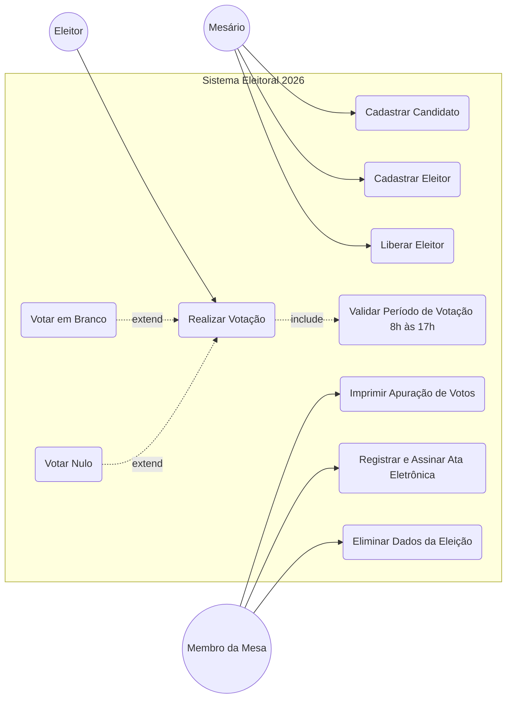
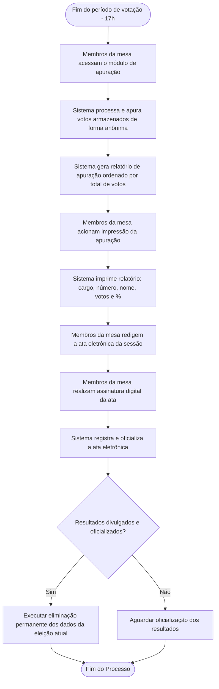
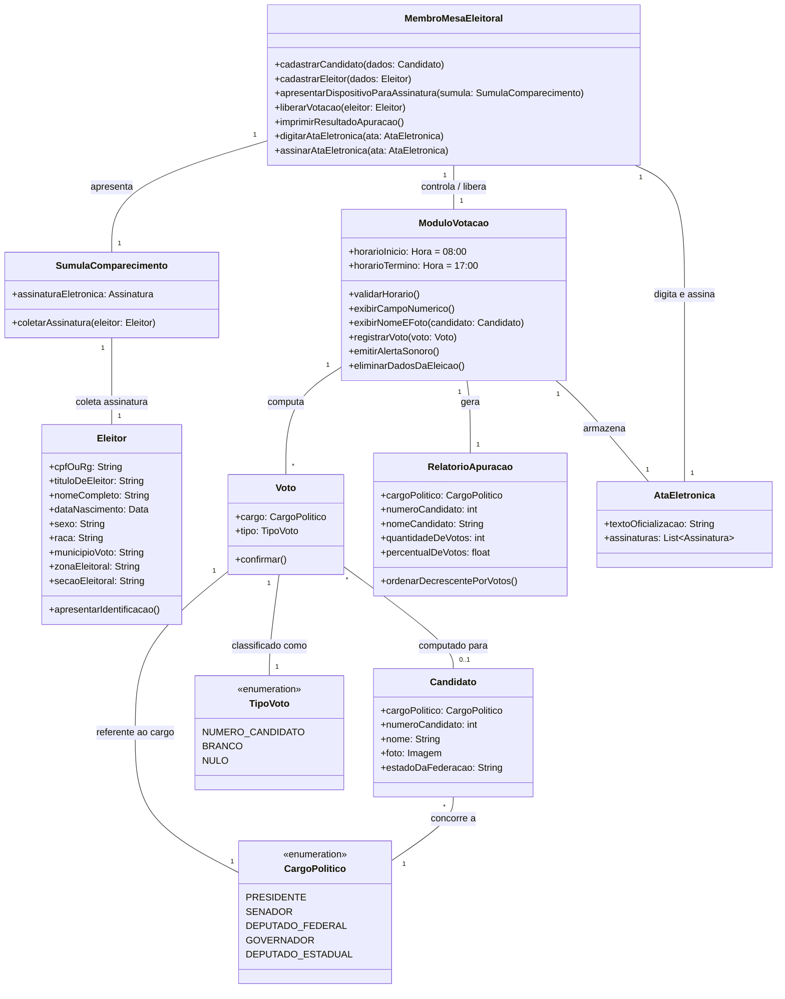

# 🗳️ Sistema Eleitoral 2026 — Documentação de Modelagem de Sistemas

Este repositório contém a documentação técnica de engenharia de requisitos e modelagem UML para o **Sistema Eleitoral 2026**, desenvolvida como parte da **Avaliação 1 da disciplina de Modelagem de Sistemas**.

O objetivo do projeto é conceber a arquitetura funcional e estrutural de um sistema de votação eletrônica, englobando desde o cadastro prévio de candidatos e eleitores, o fluxo de votação no dia do pleito, até a apuração, emissão de ata e expurgo seguro dos dados.

---

## 👨‍💻 Autores
* **Pedro Furtado Souza Müller Giancoli**
* **Pablo Henrique Vieira da Silva**

---

## 📌 1. Requisitos Funcionais (RF)

| ID | Nome | Descrição |
| :--- | :--- | :--- |
| **RF01** | Cadastrar candidatos | Módulo para mesários registrarem cargo político, número, nome, foto e estado da federação. |
| **RF02** | Cadastrar eleitores | Módulo para registro de CPF/RG, título de eleitor, nome completo, data de nascimento, sexo, raça, município, zona e seção. |
| **RF03** | Restringir horário de votação | O processo de votação só pode ocorrer estritamente entre 8h e 17h no dia da eleição. |
| **RF04** | Coletar assinatura eletrônica | Apresentação de súmula de comparecimento em dispositivo controlado pelo mesário para coleta da assinatura do eleitor. |
| **RF05** | Liberar votação | Liberação da interface de votação ao eleitor apenas após identificação e assinatura da súmula. |
| **RF06** | Exibir campo de votação | Apresentação de campo numérico na tela de votação para inserção do número do candidato. |
| **RF07** | Apresentar dados do candidato | Exibição automática do nome e foto do candidato correspondente ao número digitado antes da confirmação. |
| **RF08** | Controlar ordem de votação | Exige sequência fixa de votos: Presidente $\rightarrow$ Senador $\rightarrow$ Deputado Federal $\rightarrow$ Governador $\rightarrow$ Deputado Estadual. |
| **RF09** | Registrar tipos de voto | Permite voto nominal (número válido), voto em branco ou voto nulo (número inexistente). |
| **RF10** | Confirmar voto | Exige que o eleitor pressione "Confirmar" para que o voto seja de fato computado. |
| **RF11** | Emitir alerta sonoro | Emissão de alerta sonoro característico após a confirmação do voto. |
| **RF12** | Garantir voto secreto | Registro de votos de forma totalmente anônima, sem vínculo entre o eleitor e a opção escolhida. |
| **RF13** | Imprimir Relatório de Apuração | Emissão de relatório ordenado de forma decrescente com cargo, número, nome, votos e percentual. |
| **RF15** | Registrar ata eletrônica | Digitação e assinatura digital de ata pelos membros da mesa eleitoral ao fim do pleito. |
| **RF16** | Eliminar dados | Procedimento funcional de exclusão permanente dos dados da eleição após divulgação e oficialização dos resultados. |

---

## 🎭 2. Diagrama de Casos de Uso

Atores mapeados:
* **Mesário**: responsável pelo cadastro e liberação do eleitor.
* **Eleitor**: interage com o terminal para realizar o voto.
* **Membro da Mesa Eleitoral**: gerencia a apuração, impressão do boletim, ata e descarte dos dados.

---

## 📝 3. Especificação Caso de Uso: UC04 — Realizar Votação

* **Número/Nome:** UC04 — Eleitor realiza votação no sistema para todos os cargos políticos incluídos nessa eleição.
* **Ator Primário:** Eleitor.
* **Entradas:** Inserção de número no teclado numérico, seleção de voto em branco, seleção de voto nulo e acionamento do botão "Confirmar".
* **Saídas:** Nome e foto do candidato em tela, emissão de alerta sonoro, mensagem de confirmação de voto por cargo e tela final de encerramento.
* **Pré-condições:** 
  1. O horário atual do sistema deve estar entre 8h e 17h.
  2. O eleitor deve ter sido identificado e assinado a súmula no terminal do mesário.
  3. O mesário deve ter liberado a interface de votação.

### Fluxo Principal
1. O sistema exibe na tela o campo de votação para o cargo de **Presidente**.
2. O eleitor digita o número do candidato desejado.
3. O sistema busca e exibe o nome e foto correspondentes, aguardando confirmação.
4. O eleitor clica em **"Confirmar"**.
5. O sistema emite o alerta sonoro, grava o voto de forma estritamente anônima e avança para o próximo cargo.
6. O sistema repete os passos de 1 a 5 para os demais cargos na ordem: **Senador**, **Deputado Federal**, **Governador** e **Deputado Estadual**.
7. Após o encerramento do último cargo, o sistema exibe a tela de finalização de votação.

### Fluxos Alternativos
* **FA01 - Voto em Branco:** No Passo 2, se o eleitor pressionar o botão de voto em branco, o sistema indica "Voto em Branco", aguarda a confirmação, registra o voto anonimamente e prossegue na sequência dos cargos.
* **FA02 - Voto Nulo:** No Passo 2, se o eleitor digitar um número não cadastrado, o sistema exibe a indicação de "Voto Nulo", aguarda confirmação, grava o voto anonimamente e avança para o próximo cargo.

---

## 🔄 4. Diagrama de Atividades — Fechamento e Resultados

Mapeamento do fluxo de encerramento da seção eleitoral às 17h até a eliminação segura dos dados.

---

## 🏗️ 5. Diagrama de Classes

Representação das entidades, atributos, métodos e relacionamentos do domínio do sistema.

